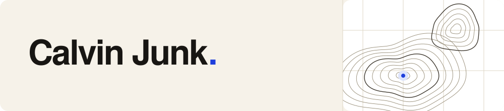

<picture>
  <source media="(prefers-color-scheme: dark)" srcset="assets/banner-dark.svg">
  
</picture>

  
  
  

Hi, I'm Calvin. I've spent most of my career working on cloud infrastructure: building it, running it, and helping teams use it without having to think about it too much.

I like simple designs, decisions that are written down with the trade-offs, and changes small enough to roll back. I'd rather use data than gut feel, both for technical choices and for helping teams see how their work flows.

## What I'm into

- Designing cloud systems on AWS, and writing down why they're built that way
- Infrastructure as code and Kubernetes
- Using data and insights to coach teams and make better decisions
- Agentic development: AI coding agents, and the guardrails that make them safe to use
- Making the day-to-day work easier for engineers

## Tools I use

<b>Cloud & platform</b> 
    

<b>Infrastructure as code & delivery</b> 
  

<b>Observability</b> 

<b>Languages</b> 
  

## Open source

| Project | What it does |
| --- | --- |
| [**ebs-snapshots-tf**](https://github.com/calvin-j/ebs-snapshots-tf) | A Terraform module for automated EBS volume backups |
